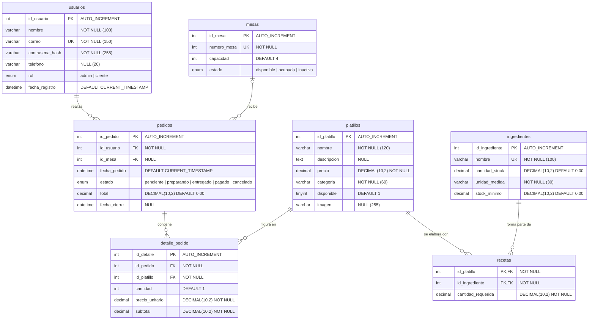

# Diagrama Entidad-Relación (ER) — `food_manager`

## Resumen de relaciones e integridad referencial

| Relación | Cardinalidad | Clave foránea | Reglas `ON DELETE` / `ON UPDATE` |
| --- | --- | --- | --- |
| `usuarios` → `pedidos` | `1 : N` | `pedidos.id_usuario` | `ON DELETE RESTRICT`, `ON UPDATE CASCADE` |
| `mesas` → `pedidos` | `0..1 : N` | `pedidos.id_mesa` | `ON DELETE SET NULL`, `ON UPDATE CASCADE` |
| `pedidos` → `detalle_pedido` | `1 : N` | `detalle_pedido.id_pedido` | `ON DELETE CASCADE`, `ON UPDATE CASCADE` |
| `platillos` → `detalle_pedido` | `1 : N` | `detalle_pedido.id_platillo` | `ON DELETE RESTRICT`, `ON UPDATE CASCADE` |
| `platillos` → `recetas` | `1 : N` | `recetas.id_platillo` | `ON DELETE CASCADE`, `ON UPDATE CASCADE` |
| `ingredientes` → `recetas` | `1 : N` | `recetas.id_ingrediente` | `ON DELETE RESTRICT`, `ON UPDATE CASCADE` |

> [!NOTE]
> Las tablas `platillos` e `ingredientes` mantienen una relación muchos a muchos (`N : M`) resuelta mediante la tabla intermedia `recetas` con clave primaria compuesta `(id_platillo, id_ingrediente)`.
