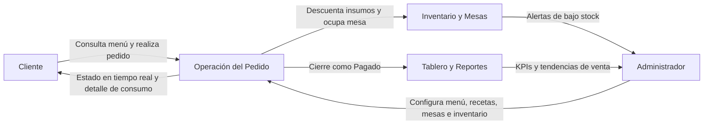
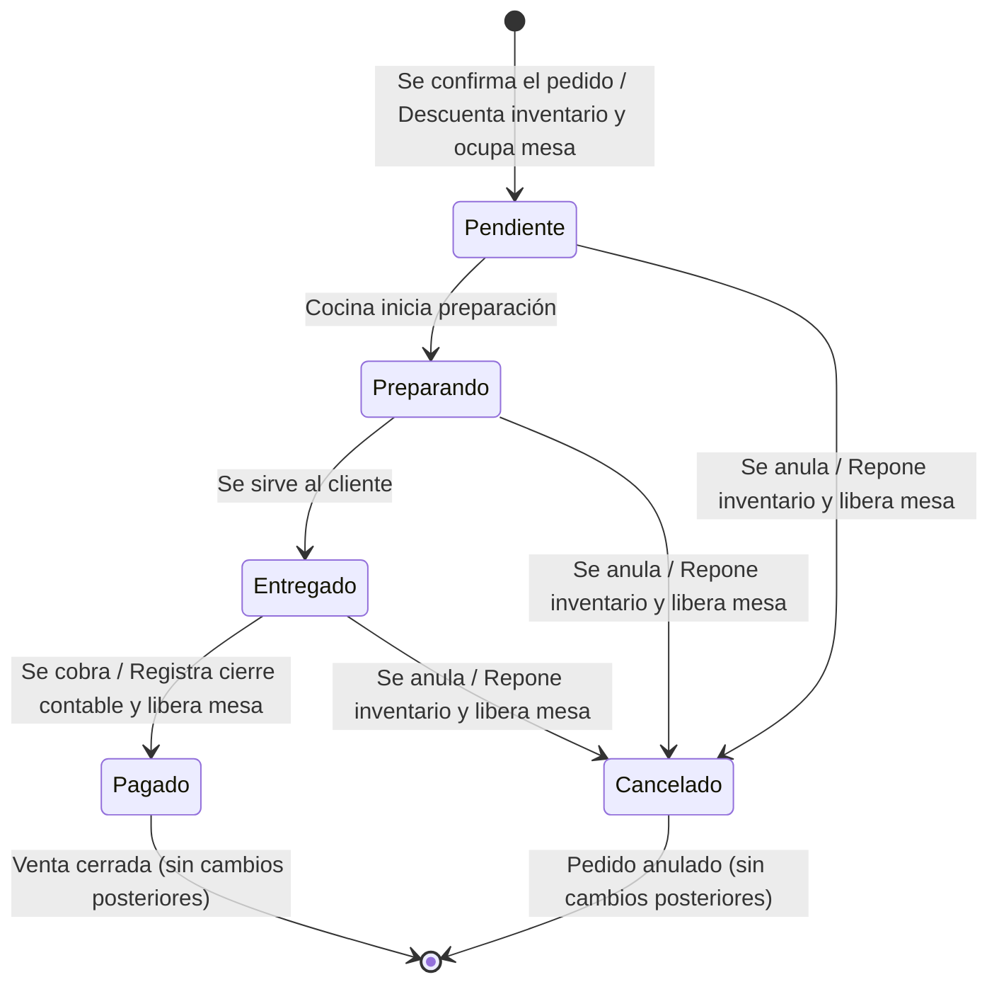

# Flujo de Información, Reglas de Negocio y Ciclo Operativo — Food Manager

Este documento describe la **Arquitectura de la Información** de **Food Manager** desde una perspectiva **funcional y de negocio**. Explica qué ocurre con la información cada vez que una persona interactúa con la aplicación, qué validaciones protegen la operación del restaurante, cómo evolucionan los estados de pedidos y mesas, y cómo se entrega información clara para la toma de decisiones.

---

## 1. Actores y recorrido general de la información

En el restaurante participan dos perfiles con necesidades de información distintas:

* **Cliente**: Consulta el menú disponible, selecciona platillos (para mesa o para llevar), confirma su pedido y da seguimiento al estado de su orden hasta recibirla y pagarla.
* **Administrador**: Configura la operación (ingredientes, platillos, recetas y mesas), supervisa la cocina y la atención en piso avanzando o cancelando pedidos, y consulta indicadores y reportes para controlar el negocio.

---

## 2. Qué ocurre en cada acción dentro de la aplicación

### 2.1 Registro e inicio de sesión
* **Qué hace el usuario**: Crea una cuenta con sus datos de contacto o ingresa con su correo y contraseña.
* **Qué pasa con la información**:
  * El sistema verifica que el correo no esté duplicado y que la contraseña sea válida.
  * La credencial se resguarda de forma cifrada para no exponer información sensible.
  * Según el perfil asignado (**Cliente** o **Administrador**), la aplicación habilita únicamente las pantallas y acciones que corresponden a su rol, evitando que un cliente modifique precios, inventario o pedidos de otras personas.

### 2.2 Preparación del catálogo, recetas e infraestructura (Administrador)
Antes de recibir pedidos, el administrador define las piezas base de la información operativa:
* **Ingredientes**: Registra cada insumo con su existencia actual, unidad de medida (kg, L, pza, etc.) y un **stock mínimo** que servirá como umbral de alerta.
* **Platillos**: Crea la oferta gastronómica con nombre, descripción, categoría, precio, fotografía opcional y disponibilidad.
* **Recetas**: Vincula cada platillo con los ingredientes y cantidades exactas necesarias para prepararlo. **Este vínculo es el corazón del control**: permite que cada venta se traduzca automáticamente en consumo real de inventario.
* **Mesas**: Da de alta las mesas del local con su número, capacidad de comensales y estado operativo.

### 2.3 Realización de un pedido (Cliente o Administrador)
* **Qué hace el usuario**: Elige uno o varios platillos del menú, indica las cantidades y selecciona una mesa disponible (o la modalidad sin mesa / para llevar).
* **Qué pasa con la información paso a paso**:
  1. **Verificación de mesa**: Si se eligió mesa, el sistema confirma que exista, que esté activa y que no esté ocupada por otro pedido en curso.
  2. **Verificación de platillos y precios oficiales**: Se confirma que cada platillo siga activo en el menú. El importe total se calcula directamente con el precio vigente del catálogo (nunca desde lo que envíe el navegador) y ese precio queda **congelado** en el detalle del pedido para que futuros cambios de carta no alteren cuentas pasadas.
  3. **Cálculo de insumos por receta**: El sistema multiplica las cantidades pedidas por la receta de cada platillo para saber exactamente cuánto se necesita de cada ingrediente.
  4. **Validación y descuento de inventario**: Se comprueba que haya stock suficiente de todos los ingredientes requeridos. Si falta aunque sea un insumo, **el pedido completo se rechaza** y no se descuenta nada ni se ocupa la mesa. Si todo alcanza, el inventario se descuenta de inmediato.
  5. **Registro y ocupación**: El pedido nace en estado **Pendiente**, se guarda su desglose por platillo y, si corresponde a una mesa, dicha mesa cambia automáticamente a **Ocupada**.

### 2.4 Seguimiento y cambio de estado de un pedido (Administrador)
Conforme avanza la preparación en cocina y la atención en piso, el administrador actualiza el estado del pedido:
* **De Pendiente a Preparando**: Indica que cocina ya tomó la orden.
* **De Preparando a Entregado**: Indica que los platillos ya fueron servidos al cliente.
* **De Entregado a Pagado**: Cierra la venta, registra la fecha y hora exacta de cobro y verifica si la mesa ya no tiene otros pedidos activos para liberarla automáticamente a **Disponible**.
* **Cancelación (desde Pendiente, Preparando o Entregado)**: Anula el pedido, **devuelve al inventario** exactamente los ingredientes que se habían descontado al crearlo y libera la mesa si no tiene otros pedidos abiertos.

### 2.5 Gestión de mesas (Administrador)
* El administrador puede habilitar o desactivar mesas (por ejemplo, por mantenimiento o cierre de zona).
* Si una mesa tiene pedidos activos (**Ocupada**), el sistema impide desactivarla para no dejar órdenes en curso sin ubicación física.

---

## 3. Transiciones de estado permitidas

Para evitar saltos ilógicos, duplicidad de cobros o devoluciones dobles de inventario, los pedidos siguen una ruta estricta:

> [!NOTE]
> Un pedido **Pagado** o **Cancelado** es definitivo. Esto garantiza que un pedido cobrado no pueda cancelarse después para alterar las ventas del día, y que un pedido cancelado no pueda volver a cancelarse para inflar el inventario.

---

## 4. Validaciones que protegen la operación

En cada punto del flujo existen reglas automáticas que aseguran la calidad y confiabilidad de los datos:

| Momento de la acción | Qué valida el sistema | Beneficio para el negocio |
| --- | --- | --- |
| **Acceso a pantallas** | Sesión iniciada y permisos de rol (`Cliente` vs. `Administrador`). | Protege configuraciones sensibles, precios, inventario y reportes financieros. |
| **Alta de inventario y menú** | Que precios, existencias y stocks mínimos no sean negativos; que las imágenes tengan formato válido y peso moderado. | Evita errores de captura que distorsionen costos, catálogos o almacenamiento. |
| **Confirmación de pedido** | Que haya al menos un platillo con cantidad positiva, platillos activos, mesa disponible y stock suficiente de todos los ingredientes. | Impide vender platillos sin insumos reales en cocina o asignar dos clientes a la misma mesa ocupada. |
| **Operaciones simultáneas** | Si dos personas intentan pedir el último insumo o la misma mesa al mismo tiempo, el sistema procesa una solicitud tras otra de forma íntegra. | Evita sobreventa de inventario y conflictos de mesas en horas pico. |
| **Cambio de estado** | Que la transición sea válida según el flujo establecido. | Mantiene coherencia entre lo que ocurre en cocina, en caja y en el inventario. |

---

## 5. Claridad de la información entregada al final

El valor de la Arquitectura de la Información radica en transformar datos operativos en respuestas claras, oportunas y fáciles de interpretar para cada usuario:

### 5.1 Lo que recibe el Cliente
* **Menú limpio y vigente**: Solo visualiza platillos marcados como disponibles, agrupados por categoría para facilitar la búsqueda.
* **Detalle transparente de su orden**: Puede consultar en todo momento qué pidió, cuántas unidades, el precio unitario, el subtotal por platillo, la mesa asignada y el total a pagar.
* **Lectura rápida del estado**: Cada pedido muestra una etiqueta visual diferenciada por color (por ejemplo: *Pendiente*, *Preparando*, *Entregado*, *Pagado* o *Cancelado*) y mensajes de confirmación o advertencia claros después de cada acción.

### 5.2 Lo que recibe el Administrador (Tablero y Reportes)
Para que las cifras financieras sean exactas, **las estadísticas de venta consideran únicamente pedidos en estado Pagado**, agrupados por su fecha real de cierre. Los pedidos pendientes o cancelados nunca inflan las ventas.

1. **Tablero principal (KPIs filtrables por fecha)**:
   * **Ventas totales** y **cantidad de pedidos pagados**.
   * **Ticket promedio** por pedido.
   * **Platillo más vendido** (en unidades).
   * **Cliente con más compras** (por frecuencia y monto).
   * **Día con mayores ventas**.
2. **Cinco reportes para la toma de decisiones**:
   * **Ventas por día**: Evolución diaria de ingresos, volumen de pedidos y ticket promedio.
   * **Platillos más vendidos**: Ranking de productos estrella por unidades e importe total generado.
   * **Clientes con más compras**: Identificación de clientes frecuentes, gasto acumulado y fecha de última visita.
   * **Estado de inventario y alertas de stock**: Listado de ingredientes ordenado por menor existencia, señalando automáticamente cuáles están en **bajo stock** (existencia igual o menor al mínimo) y cuánta diferencia falta o sobra respecto al umbral.
   * **Historial completo de pedidos**: Consulta integral de todas las órdenes (activas, pagadas y canceladas) filtrables por estado y rango de fechas para auditoría operativa.
